<div align="center">

# ATLAS-DIAG

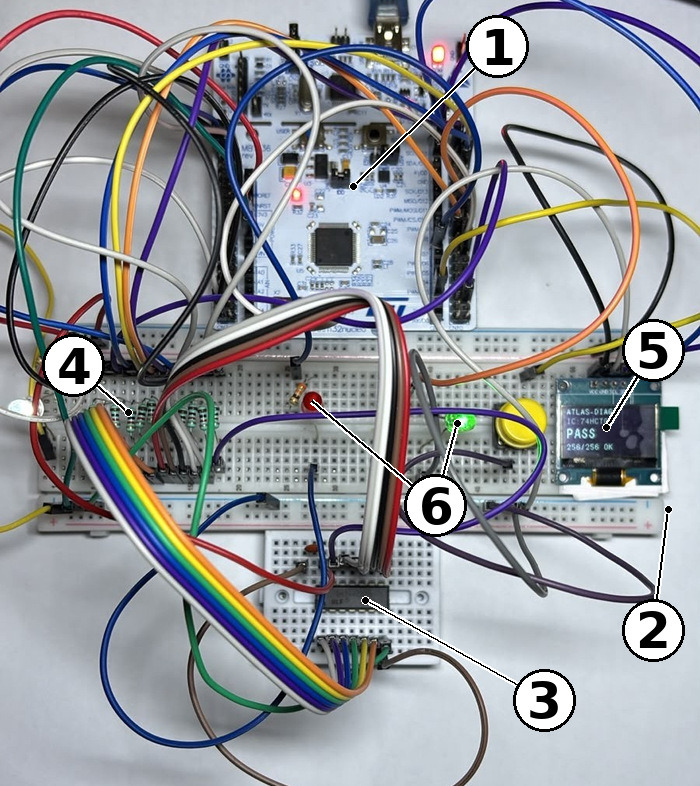

A low-cost tester for 74HCT logic chips that names the stuck pin, built on an STM32 NUCLEO-F446RE and driven by a Python digital twin.


</div>

ATLAS-DIAG tests six 74HCT logic chips (00, 02, 04, 08, 32 and 86) and, when one fails, says which pin is stuck and whether it is stuck high or low. A Python model of each chip simulates all 24 single stuck-at pin faults, finds the smallest set of input vectors that still tells those faults apart, and exports the result as C tables for the STM32 firmware. On the board, the two or three compacted vectors name the fault; then every input combination is compared with the model, so a chip that passes has passed a full functional check. The tester works on its own with an OLED and a single button, or from a PC through a command-line tool and a Streamlit dashboard, and its parts cost 4,363 INR.

*Photo key: 1 NUCLEO-F446RE, 2 main breadboard, 3 chip under test on a small breadboard, 4 the twelve 1 kΩ series resistors, 5 SSD1306 OLED, 6 PASS (green) and FAULT (red) LEDs.*

## Numbers at a glance

| Item | Value |
|---|---|
| Chips supported | 74HCT00, 74HCT02, 74HCT04, 74HCT08, 74HCT32, 74HCT86 (14-pin DIP) |
| Fault model | 24 single stuck-at faults per chip (12 signal pins, stuck-LO or stuck-HI), 25 behaviours with the good chip |
| Test compaction | 256 to 3 vectors (98.8 %) for the quad gates, 64 to 2 (96.9 %) for the 74HCT04, minimal by exhaustive search |
| Quick test (compacted vectors) | about 0.015 to 0.02 s |
| Full check (all 2^n vectors) | about 1.1 s in PC mode, about 1 s standalone |
| Good 74HCT00 against the twin | 256 of 256 vectors match |
| Simulated injection of 144 faults | 72 named uniquely, 72 named as an equivalence class, none missed |
| Fault injected on real silicon | pin 11 of a 74HCT00 tied to ground, reported as `G4 OUT stuck-LO` with 192/256 vectors wrong, as the twin predicts |
| Firmware footprint | 33,844 B flash (6.5 %), 1,880 B RAM |
| Parts cost | 4,363 INR for the tester; commercial bench testers cost about 9,000 to 35,000 INR |

## How it works

The digital twin in `software/digital_twin.py` is the single source of truth. It holds the pin-out and gate logic of each chip, simulates every single stuck-at fault, and picks test vectors with a greedy pair-separating search: each step adds the vector that tells apart the most pairs of behaviours still confused. For a quad 2-input gate that is 300 pairs, and three vectors separate every pair that can be separated at all. `generate_ic_tables.py` writes the vectors, the fault dictionary and the full fault-free response table to JSON for the PC tools and to C headers for the firmware, so the PC and the board always use the same tables.

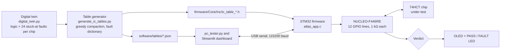

Every test has two stages. The compacted vectors give a short output signature, which is looked up in the fault dictionary. The board then applies all 2^n input combinations (256 for the quad gates, 64 for the inverter) and compares each response with the twin's golden table. A chip only shows PASS when every combination matches.

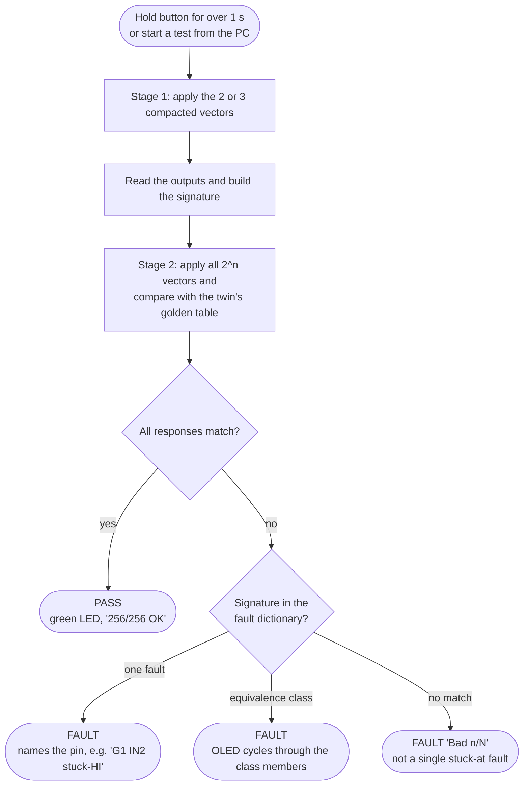

Some faults cannot be told apart by any test applied at the pins. On a NAND gate, an input stuck low forces the output high, so it looks exactly like the output stuck high. The tester reports these as a class (for example `G1 OUT stuck-HI` or `G1 IN1 stuck-LO` or `G1 IN2 stuck-LO`) and does not guess.

In standalone mode the firmware always runs both stages. On the PC the stages are separate: use `pc_tester.py --verify`, the dashboard's Full verify button or the All-IC session (which always runs the full check) before trusting a PASS. A quick test on its own is labelled `quick test OK`.

<details>
<summary>System block diagram</summary>

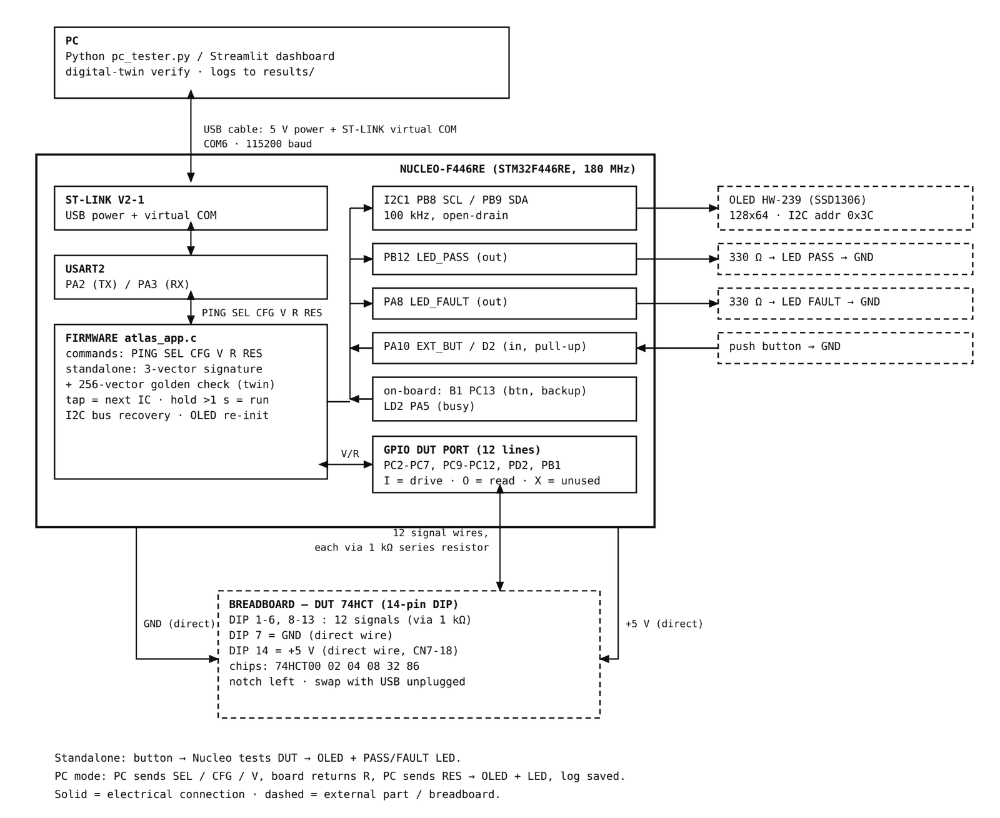

</details>

## Gallery

<table>
  <tr>
    <td align="center" width="33%"><br><sub>Bench prototype, numbered as in the photo key above</sub></td>
    <td align="center" width="33%">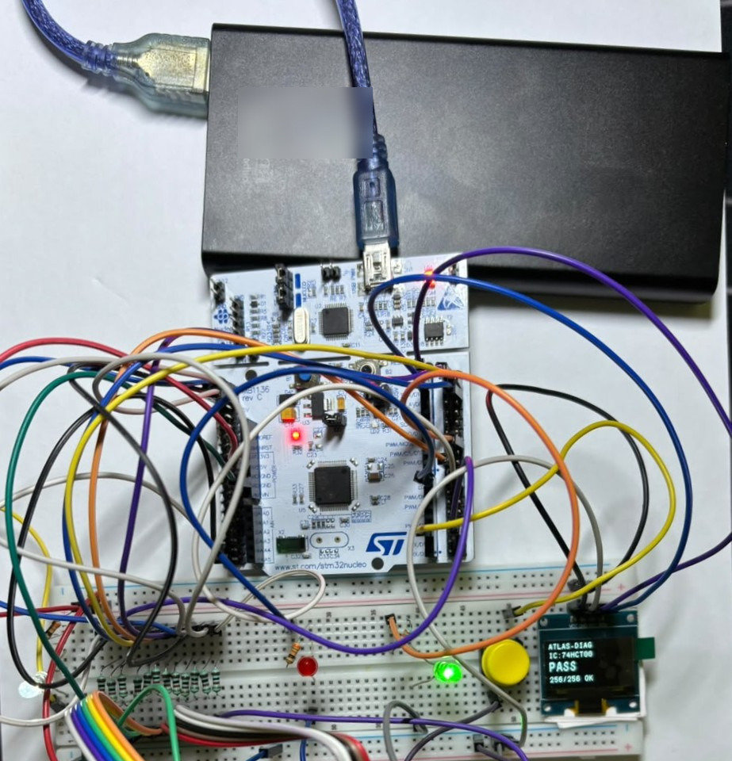<br><sub>Standalone on a USB power bank: 74HCT00 passes 256/256</sub></td>
    <td align="center" width="33%">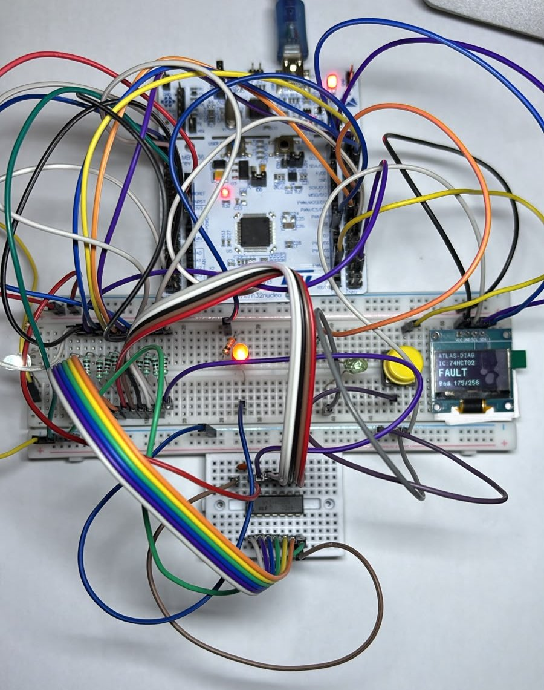<br><sub>Standalone FAULT: red LED, OLED shows <code>Bad 175/256</code></sub></td>
  </tr>
  <tr>
    <td align="center">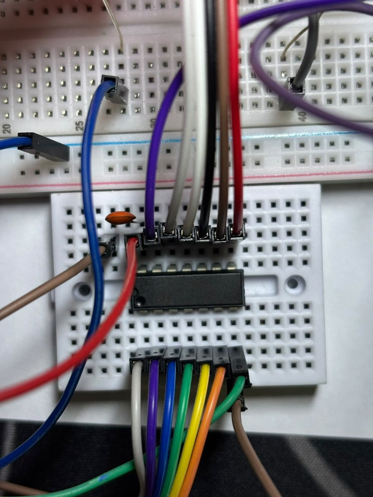<br><sub>Chip pressed straight into a small breadboard (no socket)</sub></td>
    <td align="center">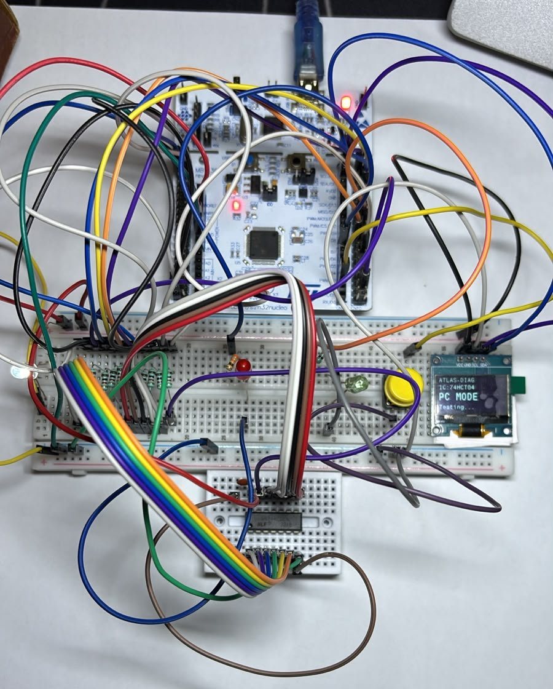<br><sub>PC mode: the OLED shows <code>PC MODE</code> while the PC drives the test</sub></td>
    <td align="center">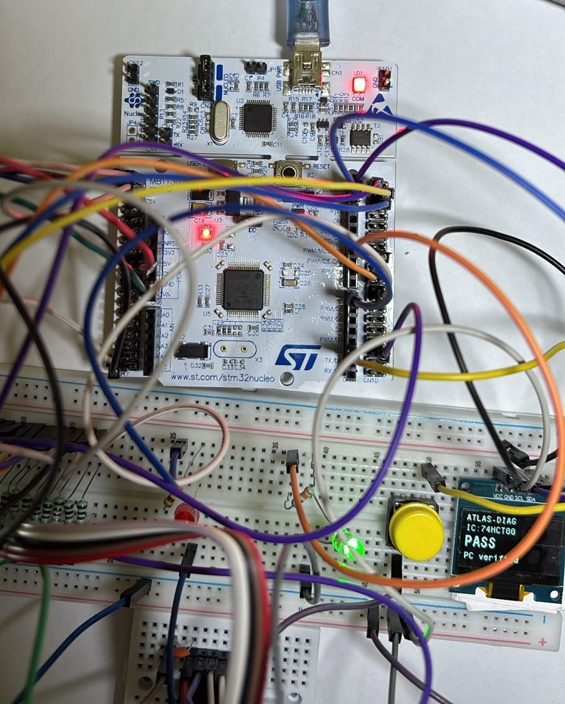<br><sub>PC-verified pass: green LED and <code>PC verified</code></sub></td>
  </tr>
  <tr>
    <td align="center">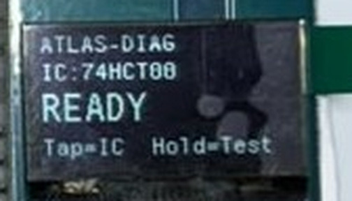<br><sub>Idle screen: <code>Tap=IC Hold=Test</code></sub></td>
    <td align="center">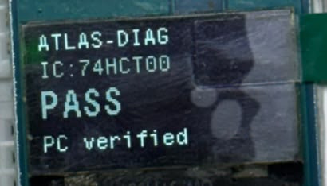<br><sub>PASS sent back by the PC</sub></td>
    <td align="center">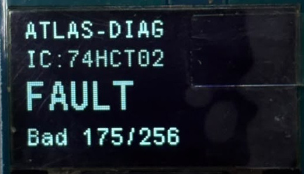<br><sub>FAULT with the mismatch count</sub></td>
  </tr>
  <tr>
    <td align="center">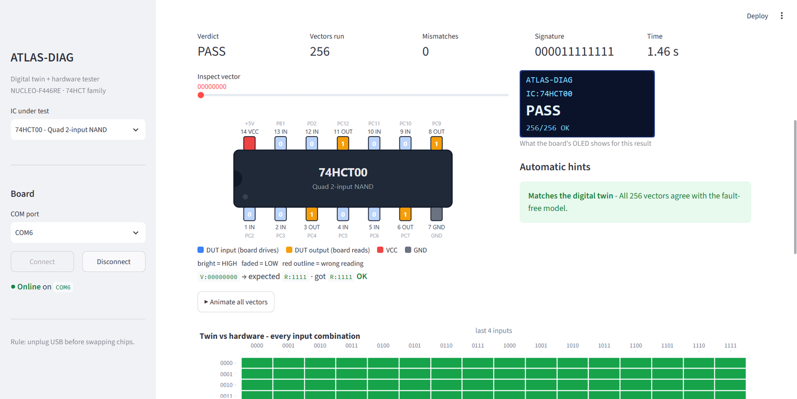<br><sub>Dashboard after a full verify of a good 74HCT00</sub></td>
    <td align="center">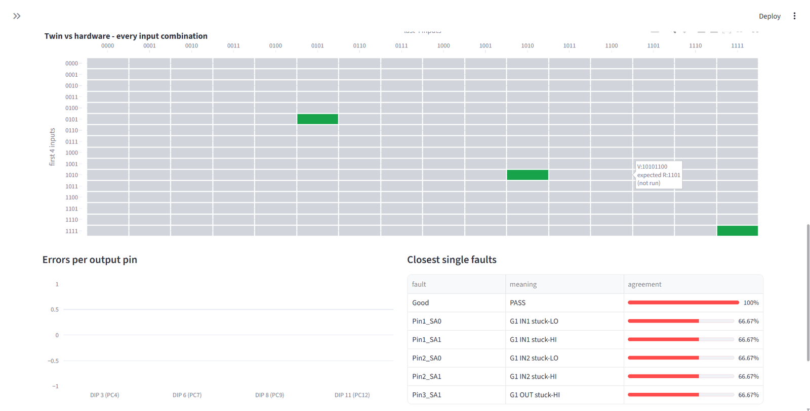<br><sub>Quick test: only the 3 compacted vectors are run (grey = not run)</sub></td>
    <td align="center"><br><sub>Full verify: twin and hardware agree on all 256 vectors</sub></td>
  </tr>
  <tr>
    <td align="center"><br><sub>Fault sandbox: inject a stuck pin in the twin</sub></td>
    <td align="center"><br><sub>Where <code>G1 IN2 stuck-HI</code> shows up: 64 of 256 vectors</sub></td>
    <td align="center"><br><sub>Compaction tab: 256 to 3 vectors, step by step</sub></td>
  </tr>
  <tr>
    <td align="center"><br><sub>Identify chip: 74HCT00 first at 256/256</sub></td>
    <td align="center">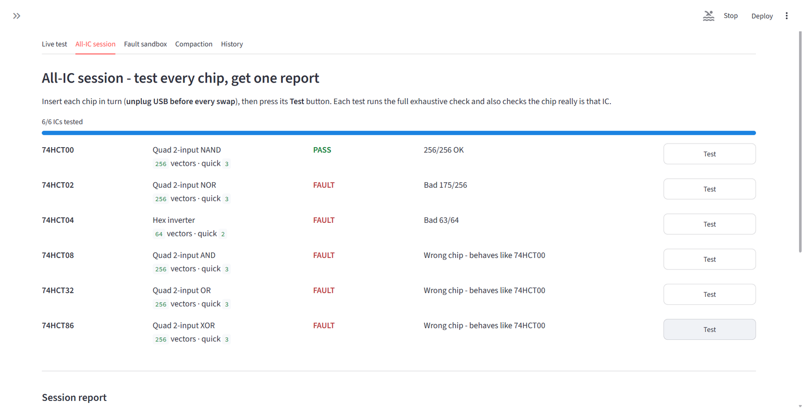<br><sub>All-IC session with one 74HCT00 in the socket</sub></td>
    <td align="center">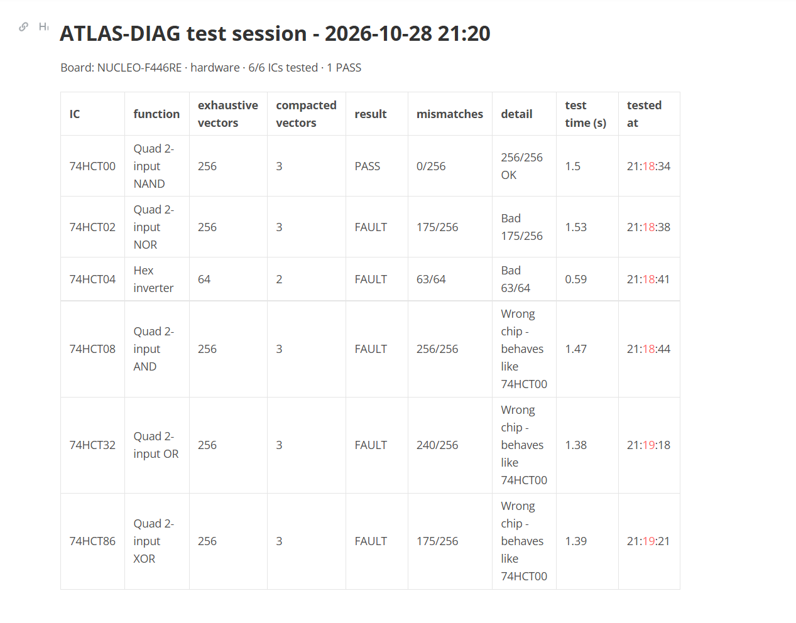<br><sub>Exported session report (Markdown)</sub></td>
  </tr>
</table>

## Quick start

### 1. Wire the hardware

[docs/HARDWARE.md](docs/HARDWARE.md) has the pin-by-pin table and the parts list with prices. In short:

| Connection | NUCLEO-F446RE pin |
|---|---|
| Chip pins 1-6 and 8-13 (12 signal lines, each through 1 kΩ) | PC2, PC3, PC4, PC5, PC6, PC7, PC9, PC10, PC11, PC12, PD2, PB1 |
| Chip pin 7 (GND) and pin 14 (+5 V) | GND and 5V, by short direct wires |
| SSD1306 OLED SCL / SDA | PB8 (D15) / PB9 (D14) |
| PASS LED (green) / FAULT LED (red), 330 Ω each | PB12 / PA8 (D7) |
| Test button to GND (internal pull-up) | PA10 (D2); the on-board B1 button works too |

No level shifter is needed: a 3.3 V output is above the 2.0 V input-high threshold of HCT logic, and the GPIO pins used are 5 V tolerant.

### 2. Flash the firmware

1. Install [STM32CubeIDE](https://www.st.com/en/development-tools/stm32cubeide.html).
2. File > Import > General > Existing Projects into Workspace, and choose the `firmware` folder. The project is called `Atlas`.
3. Build (Project > Build Project), connect the NUCLEO over USB and use Run > Run As > STM32 C/C++ Application.
4. With no chip inserted, the OLED should show `READY` and `Tap=IC Hold=Test`.

The serial protocol and the LED meanings are in [docs/FIRMWARE.md](docs/FIRMWARE.md).

### 3. Run the PC software

```powershell
cd software
python -m venv .venv
.venv\Scripts\activate          # Linux/macOS: source .venv/bin/activate
pip install -r requirements.txt
streamlit run dashboard.py      # or double-click run_dashboard.bat on Windows
```

The dashboard opens at `http://localhost:8501`. Pick the board's COM port in the sidebar and click Connect. Without hardware, choose `Simulated board (demo)` as the port: you can put any of the six chips "in the socket" with any single stuck-at fault, or with no VCC, a weak ground or a loose contact. The Fault sandbox and Compaction tabs work offline with no board at all.

Command-line tester (`pc_tester.py`):

```powershell
# full check of all 256 vectors against the twin, then the 3-vector diagnosis
python pc_tester.py --ic 74HCT00 --port COM6 --verify

# quick diagnosis only (compacted vectors)
python pc_tester.py --ic 74HCT04 --port COM6

# Linux, explicit baud rate
python pc_tester.py --ic 74HCT86 --port /dev/ttyACM0 --baudrate 115200 --verify
```

| Option | Meaning | Default |
|---|---|---|
| `--ic` | one of `74HCT00`, `74HCT02`, `74HCT04`, `74HCT08`, `74HCT32`, `74HCT86` | `74HCT00` |
| `--port` | serial port of the ST-LINK virtual COM port | `COM3` |
| `--baudrate` | must match the firmware | `115200` |
| `--verify` | run every input combination against the twin before diagnosing | off |

Each run is saved as JSON in `software/results/`. Close the dashboard or any serial monitor first, since only one program can hold the COM port.

Checks that need no hardware:

```powershell
python -m unittest test_digital_twin -v   # truth tables, compaction, gate map
python verify_all_ics.py                  # every chip x every fault through the dashboard's diagnosis logic
python generate_ic_tables.py              # only after editing digital_twin.py; rewrites tables/ and firmware headers
```

[docs/SOFTWARE.md](docs/SOFTWARE.md) explains the twin and each dashboard tab in more detail.

## Repository layout

```
ATLAS-DIAG/
├── README.md
├── LICENSE                 MIT (ST files under firmware/Drivers keep their own licences)
├── CITATION.cff
├── docs/
│   ├── HARDWARE.md         wiring, bill of materials, safety
│   ├── FIRMWARE.md         build and flash, serial protocol, standalone use
│   ├── SOFTWARE.md         digital twin, table generator, pc_tester, dashboard
│   ├── RESULTS.md          measurements and plots
│   └── images/             photos, screenshots, plots
├── firmware/               STM32CubeIDE project "Atlas" for the NUCLEO-F446RE
│   ├── Atlas.ioc           CubeMX pin and clock configuration
│   ├── Core/Src/           atlas_app.c (tester logic), main.c, ssd1306.c (OLED driver)
│   ├── Core/Inc/           ic_table_*.h (generated by the twin), headers
│   ├── Core/Startup/       startup_stm32f446retx.s
│   ├── Drivers/            ST HAL and CMSIS
│   └── STM32F446RETX_FLASH.ld, STM32F446RETX_RAM.ld
├── software/
│   ├── digital_twin.py     chip models, fault simulation, greedy compaction
│   ├── generate_ic_tables.py
│   ├── pc_tester.py        command-line tester
│   ├── dashboard.py        Streamlit dashboard
│   ├── atlas_core.py       board link, simulated board, analysis used by the dashboard
│   ├── test_digital_twin.py, verify_all_ics.py
│   ├── tables/             exported JSON tables and compaction_stats.json
│   ├── requirements.txt
│   └── run_dashboard.bat
└── data/
    ├── README.md           field-by-field description of the logs
    ├── results/            165 JSON run logs (30 Sep, 1 Oct and 28 Oct 2026)
    ├── sessions/           all-IC session reports (CSV and Markdown)
    ├── atlas_history.csv   history table exported from the dashboard
    └── compaction_stats.csv
```

## Results

Full tables and plots are in [docs/RESULTS.md](docs/RESULTS.md); the raw logs are in [data/](data/).

Test compaction (from the twin; minimality confirmed by exhaustive search):

| Chip | Function | Exhaustive | Compacted | Reduction | Distinct signatures | Equivalence classes |
|---|---|---|---|---|---|---|
| 74HCT00 | quad 2-input NAND | 256 | 3 | 98.8 % | 17 | 4 classes of 3 faults |
| 74HCT02 | quad 2-input NOR | 256 | 3 | 98.8 % | 17 | 4 classes of 3 faults |
| 74HCT04 | hex inverter | 64 | 2 | 96.9 % | 13 | 12 classes of 2 faults |
| 74HCT08 | quad 2-input AND | 256 | 3 | 98.8 % | 17 | 4 classes of 3 faults |
| 74HCT32 | quad 2-input OR | 256 | 3 | 98.8 % | 17 | 4 classes of 3 faults |
| 74HCT86 | quad 2-input XOR | 256 | 3 | 98.8 % | 25 | none |

All-IC session on hardware, with one good 74HCT00 in the socket tested against each of the six chip profiles. The result was identical in four sessions on 1 Oct and 28 Oct 2026.

| Profile selected | Verdict | Mismatching vectors | Note |
|---|---|---|---|
| 74HCT00 | PASS | 0/256 | the chip that is actually inserted |
| 74HCT02 | FAULT | 175/256 | different pin-out |
| 74HCT04 | FAULT | 63/64 | different pin-out |
| 74HCT08 | FAULT | 256/256 | flagged as a wrong chip that behaves like 74HCT00 |
| 74HCT32 | FAULT | 240/256 | flagged as a wrong chip that behaves like 74HCT00 |
| 74HCT86 | FAULT | 175/256 | flagged as a wrong chip that behaves like 74HCT00 |

For the three profiles that share the 74HCT00 pin-out, the count follows `2^8 - a^4`, where `a` is the number of the four input pairs on which the two gate functions agree (AND 0, OR 2, XOR 3). The dashboard's Identify chip button ranks the same 74HCT00 first at 256/256, followed by 74HCT02 and 74HCT86 at 81/256.

Fault injection:

| Test | Result |
|---|---|
| Simulated, all 144 faults (6 chips x 24) through the tester's decision logic | 72 named uniquely, 24 in classes of 2 (all on the 74HCT04), 48 in classes of 3, none missed; all six good chips pass |
| On hardware: pin 11 (gate 4 output) of a good 74HCT00 tied to ground | named `G4 OUT stuck-LO`; 192/256 vectors mismatch, matching the twin's prediction |

## Roadmap

- Inject all 24 faults physically on real chips (so far one fault has been tested on silicon; the rest are simulated).
- Run chip identification on the board itself, without a PC.
- Support 16-pin packages and sequential parts.
- Add a phone front end.

## Citation

If you use this work, please cite it using [CITATION.cff](CITATION.cff) (GitHub shows a "Cite this repository" button for it).

```bibtex
@software{atlas_diag_2026,
  author  = {Chordia, Arihant and {B J}, Manasa and {C P}, Alan Sham},
  title   = {{ATLAS-DIAG}: A Low-Cost Digital-Twin-Driven Tester for Pin-Level Stuck-at Fault Diagnosis of 74HCT Logic Chips},
  year    = {2026},
  version = {1.0.0},
  url     = {https://github.com/Arii-git/ATLAS-DIAG}
}
```

## Licence

The project's own code and documentation are released under the [MIT licence](LICENSE). Files under `firmware/Drivers/` are STMicroelectronics HAL and CMSIS sources and keep their own licences (BSD-3-Clause and Apache-2.0, see the `LICENSE.txt` files in those folders). The SSD1306 driver in `firmware/Core/Src/ssd1306.c` comes from [afiskon/stm32-ssd1306](https://github.com/afiskon/stm32-ssd1306) (MIT), originally written by Olivier Van den Eede.

## Authors

- Arihant Chordia
- Manasa B J
- Alan Sham C P

Department of Electronics and Communication Engineering, SRM Institute of Science and Technology, Kattankulathur, Chennai, India.

## Acknowledgement

We thank the Department of Electronics and Communication Engineering, SRM Institute of Science and Technology, Kattankulathur, for supporting this project.
