# Results

All hardware results were measured on the bench prototype described in [HARDWARE.md](HARDWARE.md), running the firmware in `firmware/`. The raw logs are in [`data/`](../data/README.md): 165 JSON run logs from 30 September, 1 October and 28 October 2026, the exported history table and the all-IC session reports.

## Test compaction

From the digital twin. "Distinct signatures" counts the different output patterns the compacted vectors produce over the 25 behaviours (24 faults plus the good chip); faults that share a signature form an equivalence class. Vector bits follow the chip's input pins in DIP order, lowest pin first.

| Chip | Function | Exhaustive | Compacted | Reduction | Compacted vectors | Distinct signatures | Equivalence classes |
|---|---|---|---|---|---|---|---|
| 74HCT00 | quad 2-input NAND | 256 | 3 | 98.8 % | `11111111`, `01010101`, `10101010` | 17 | 4 classes of 3 |
| 74HCT02 | quad 2-input NOR | 256 | 3 | 98.8 % | `00000000`, `01010101`, `10101010` | 17 | 4 classes of 3 |
| 74HCT04 | hex inverter | 64 | 2 | 96.9 % | `000000`, `111111` | 13 | 12 classes of 2 |
| 74HCT08 | quad 2-input AND | 256 | 3 | 98.8 % | `11111111`, `01010101`, `10101010` | 17 | 4 classes of 3 |
| 74HCT32 | quad 2-input OR | 256 | 3 | 98.8 % | `00000000`, `01010101`, `10101010` | 17 | 4 classes of 3 |
| 74HCT86 | quad 2-input XOR | 256 | 3 | 98.8 % | `00000000`, `01010101`, `10101010` | 25 | none |

An exhaustive search over all smaller vector sets confirms that the greedy sets are minimal: no set with fewer vectors reaches the same number of distinct signatures. The equivalence classes are pin-level fault equivalence, which no test at the pins can split. On the 74HCT00, for example, `G1 IN1 stuck-LO`, `G1 IN2 stuck-LO` and `G1 OUT stuck-HI` all force gate 1's output high.

<table>
  <tr>
    <td align="center" width="50%">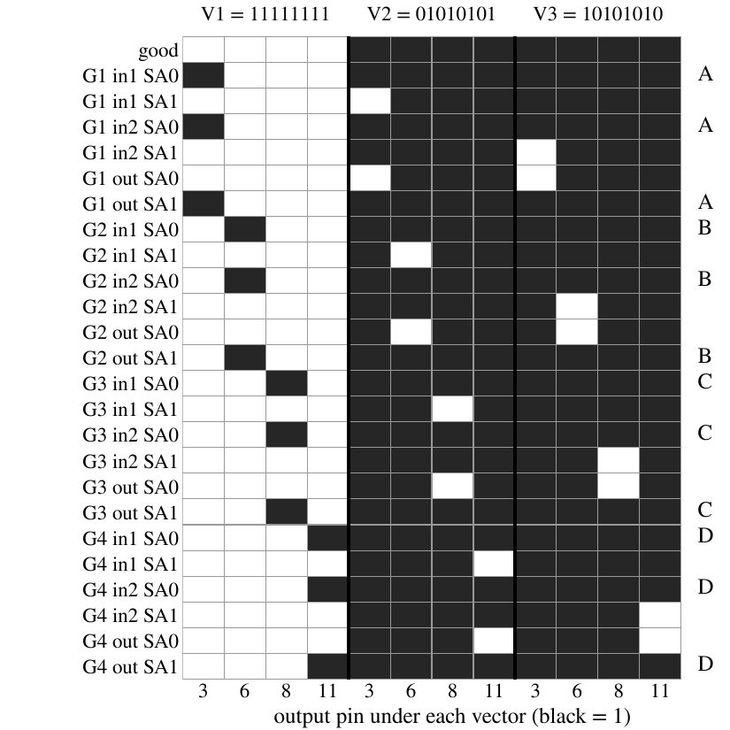 74HCT00: output of each behaviour under the three vectors (black = 1). Letters mark the four equivalence classes.</td>
    <td align="center" width="50%">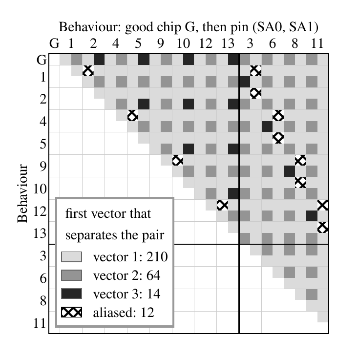 74HCT00: the vector that first separates each of the 300 pairs (vector 1: 210, vector 2: 64, vector 3: 14, never: 12).</td>
  </tr>
  <tr>
    <td align="center">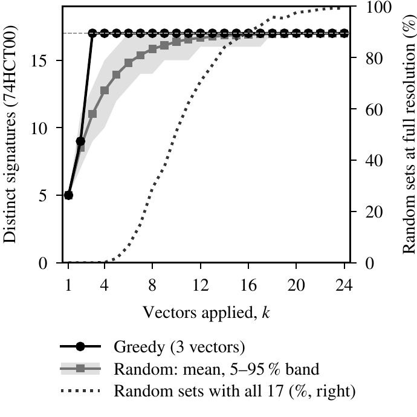 Greedy reaches all 17 signatures with 3 vectors; random vector sets need many more.</td>
    <td align="center">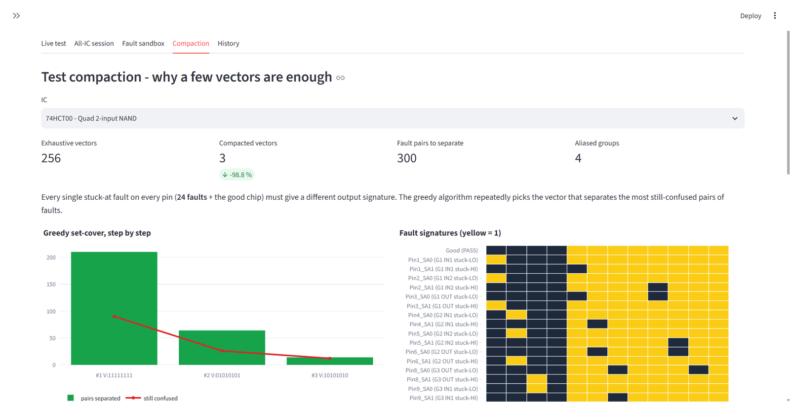 The same analysis in the dashboard's Compaction tab.</td>
  </tr>
</table>

## Twin against hardware

A good 74HCT00 matches the twin on 256 of 256 input combinations.

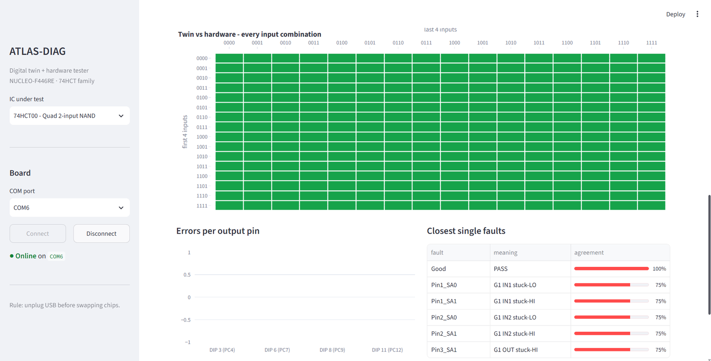

| Measurement | Value |
|---|---|
| Quick test (3 vectors, PC mode) | about 0.015 to 0.02 s |
| Full check (256 vectors, PC mode) | about 1.1 s |
| Full test in standalone mode (both stages) | about 1 s |

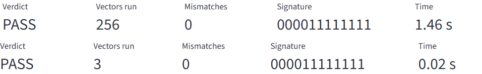

*Dashboard metrics for the same good 74HCT00: full verify (top) and quick test (bottom). The run in this screenshot took 1.46 s; the logged full checks take about 1.1 s.*

## Wrong-chip detection (all-IC session)

One good 74HCT00 stayed in the socket while the All-IC session tested it against each of the six chip profiles. The result was identical in four sessions on 1 October and 28 October 2026. The table is the 28 October session ([data/sessions/](../data/sessions/)).

| Profile | Verdict | Mismatching vectors | Dashboard detail | Session time (s) |
|---|---|---|---|---|
| 74HCT00 | PASS | 0/256 | `256/256 OK` | 1.50 |
| 74HCT02 | FAULT | 175/256 | `Bad 175/256` | 1.53 |
| 74HCT04 | FAULT | 63/64 | `Bad 63/64` | 0.59 |
| 74HCT08 | FAULT | 256/256 | `Wrong chip - behaves like 74HCT00` | 1.47 |
| 74HCT32 | FAULT | 240/256 | `Wrong chip - behaves like 74HCT00` | 1.38 |
| 74HCT86 | FAULT | 175/256 | `Wrong chip - behaves like 74HCT00` | 1.39 |

Session times include selecting the profile, configuring the pins and the wrong-chip comparison, on top of the 256-vector run.

For the profiles that share the 74HCT00 pin-out (08, 32, 86), each of the four gates is a separate 2-input function. If the expected function and the NAND agree on `a` of the 4 input pairs, the whole chip agrees on `a^4` of the 256 vectors, so the mismatch count is `2^8 - a^4`. AND agrees with NAND nowhere (`a = 0`, 256 wrong), OR on 2 pairs (240 wrong), XOR on 3 pairs (175 wrong). The measured counts match.

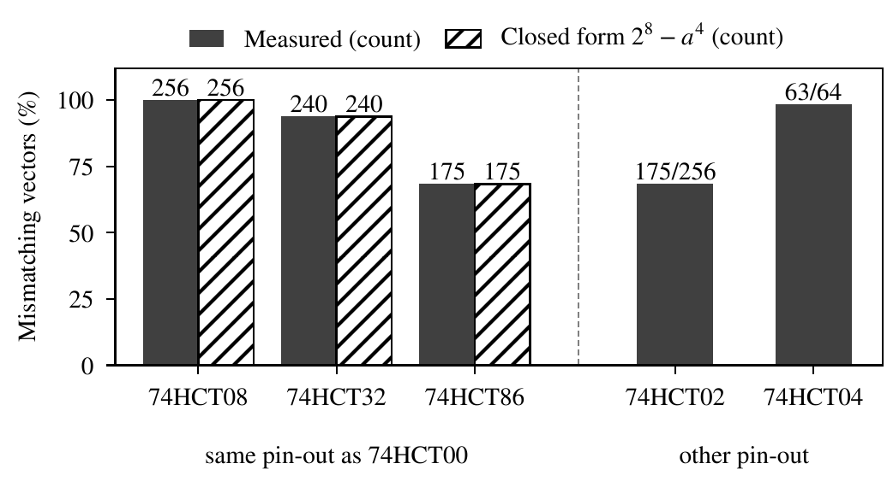

The Identify chip button ranks the six profiles by matching vectors. With the same 74HCT00 inserted:

| Rank | Profile | Matching vectors |
|---|---|---|
| 1 | 74HCT00 | 256/256 |
| 2 | 74HCT02 | 81/256 |
| 2 | 74HCT86 | 81/256 |
| 4 | 74HCT32 | 16/256 |
| 5 | 74HCT04 | 1/64 |
| 6 | 74HCT08 | 0/256 |

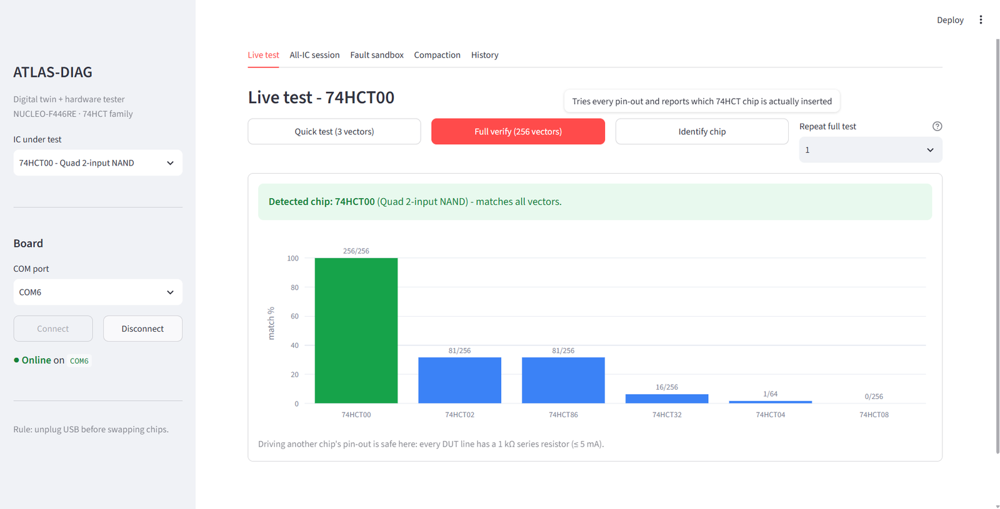

## Fault injection

### Simulated, all faults

All 144 single stuck-at faults (6 chips, 12 signal pins each, stuck low or stuck high) were injected into the twin and passed through the tester's decision logic (`software/verify_all_ics.py` runs the same check):

| Outcome | Faults |
|---|---|
| Named uniquely | 72 |
| Named as a class of 2 (all on the 74HCT04) | 24 |
| Named as a class of 3 | 48 |
| Missed | 0 |

All six good chips pass.

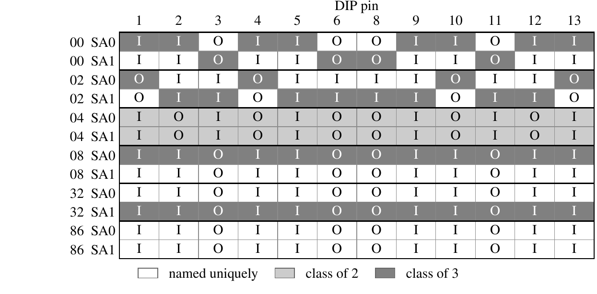

*Each row is one chip and one fault polarity; each column is a DIP pin (I = chip input, O = chip output). White: named uniquely; light grey: class of 2; dark grey: class of 3.*

### On hardware

Pin 11 (the output of gate 4) of a good 74HCT00 was tied to ground. The quick test returned signature `000011101110`, which the fault dictionary maps to `G4 OUT stuck-LO` alone. The full check found 192 of 256 vectors wrong, which is what the twin predicts: a NAND output is high for 3 of its 4 input pairs, so a stuck-low output is wrong on 3/4 of all vectors. Logs: `data/results/74HCT00_20261001_090709_dash.json` (quick) and `74HCT00_20261001_090730_dash.json` (full).

Physical injection of the remaining faults is future work.

<table>
  <tr>
    <td align="center" width="50%">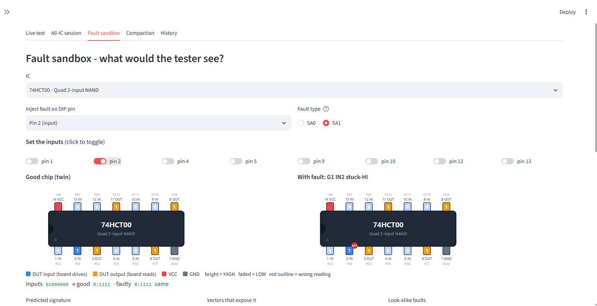 Fault sandbox: the same kind of fault injected in the twin.</td>
    <td align="center" width="50%">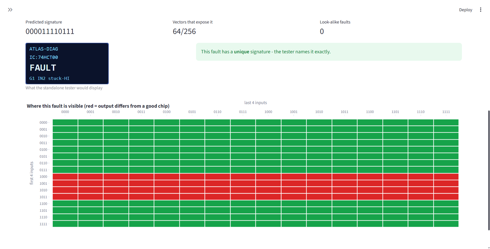 Input combinations that expose <code>G1 IN2 stuck-HI</code> (64 of 256).</td>
  </tr>
</table>

## Firmware footprint

| Resource | Used |
|---|---|
| Flash | 33,844 B (6.5 % of 512 KB) |
| RAM | 1,880 B |

## Cost

| Item | INR |
|---|---|
| ATLAS-DIAG tester (parts, see [HARDWARE.md](HARDWARE.md)) | 4,363 |
| Six test chips | 225 |
| Commercial bench IC tester | about 9,000 (Kitek DICT-01) to 35,000 (institutional estimate) |
